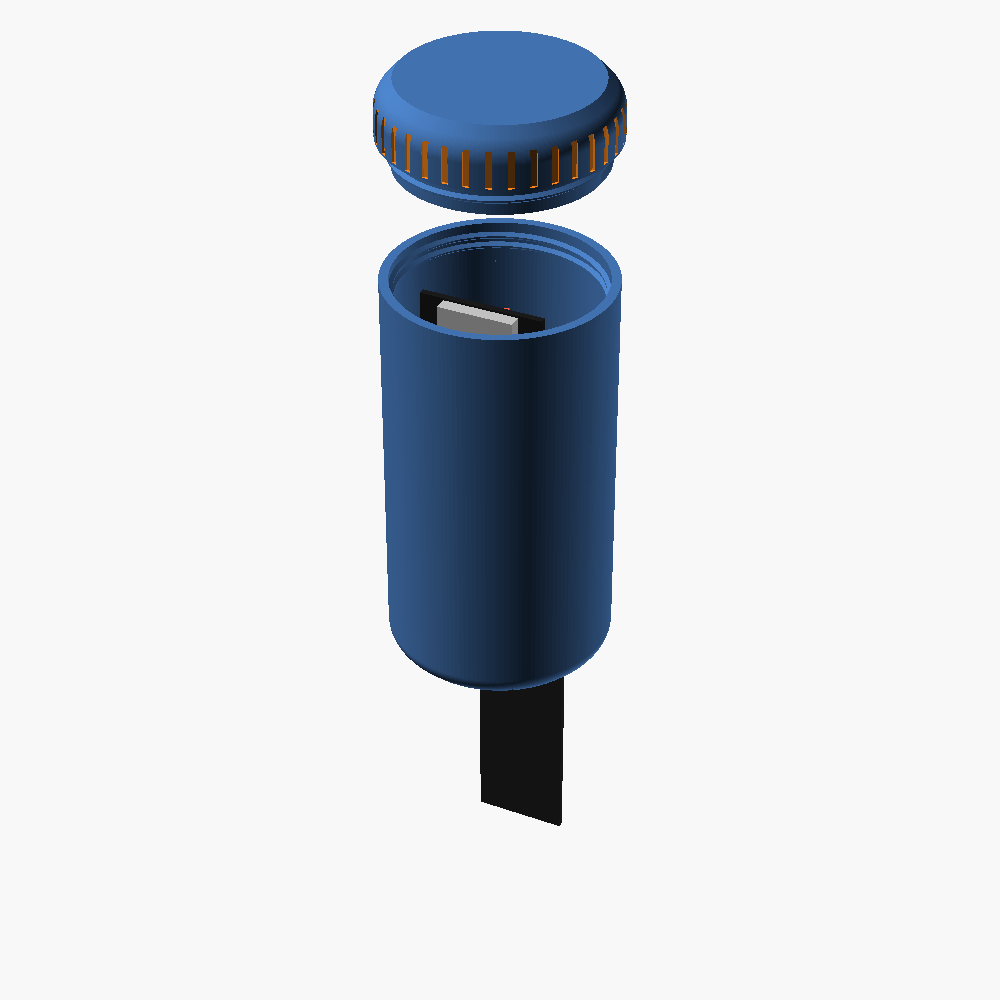
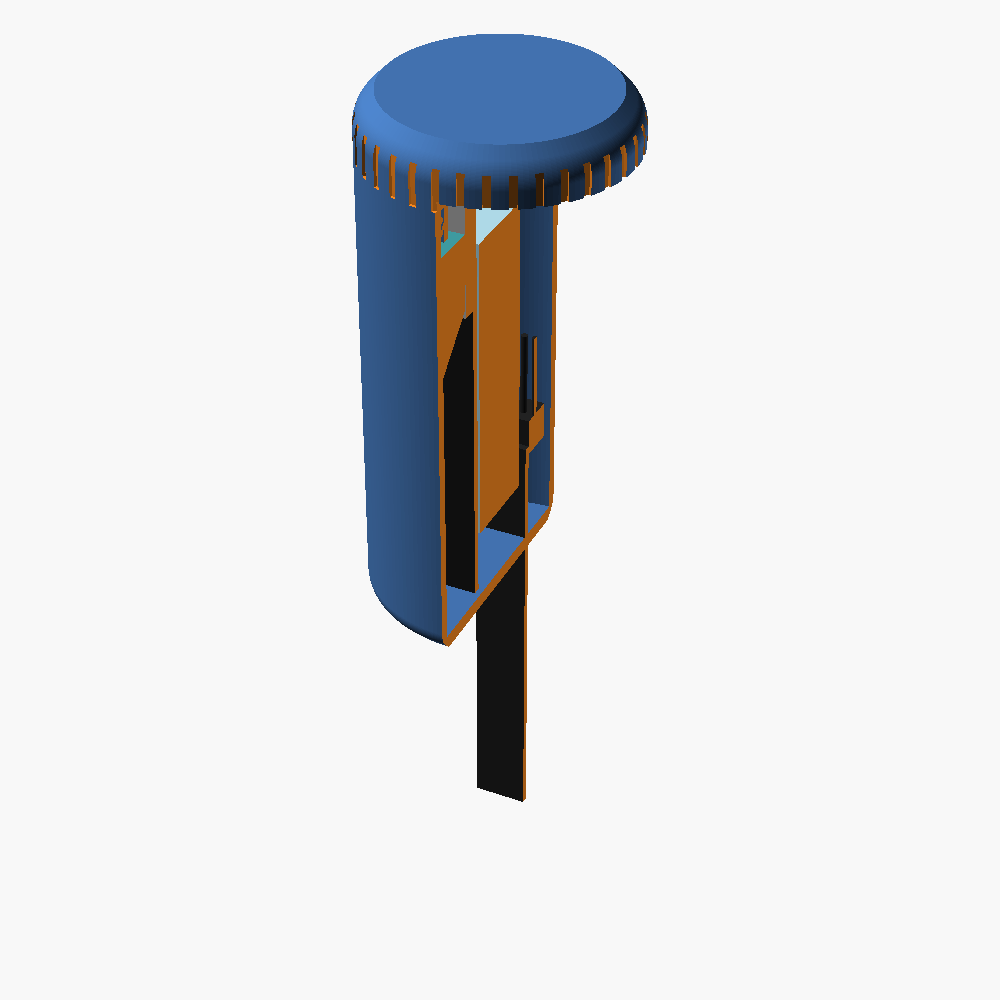
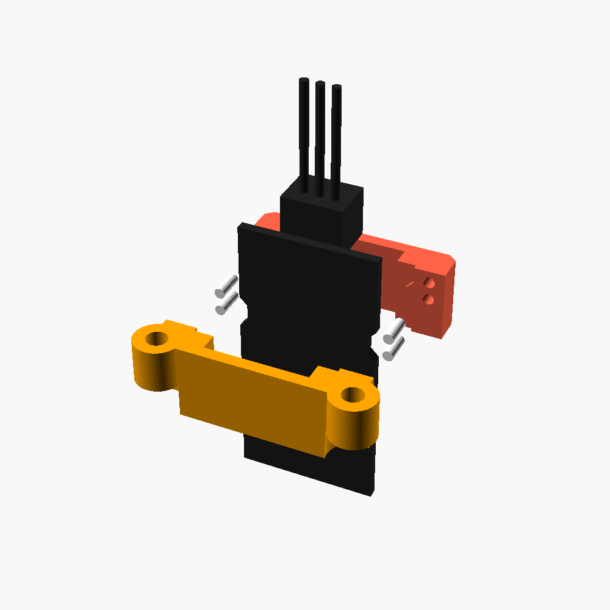

# Plant Panel

A battery-powered soil moisture sensor for house plants, with a self-hosted web panel.

The sensor wakes up on a schedule, measures soil moisture, sends it over MQTT in about half a
second, and goes back to deep sleep. A small Docker service stores the readings and shows each
plant on a web page with its photo, history graphs and device status.

For the full story behind the project, read the detailed article:
[Building a battery-powered soil moisture sensor](https://bilketay.com/writing/battery-soil-moisture-sensor).

<p align="center">
  
  
</p>

## Features

**Sensor (ESPHome firmware)**
- Deep sleep between readings; a normal wake-up takes ~0.5 s from boot to the last MQTT message.
- Delivery confirmation: every wake-up waits for its own QoS 1 message to come back from the broker
  before sleeping, so readings are not lost on a weak signal.
- Retries after 5 minutes when a send fails, then falls back to the normal interval to save the battery.
- Low battery protection: below a set voltage it sleeps for 24 hours without turning on WiFi.
- Diagnostic counters kept in RTC memory (missed wake-ups, errors, disconnects, last error type).
- Built-in settings web page (Turkish UI) that runs only in setup mode: WiFi, MQTT, measurement
  interval, low battery threshold, a calibration wizard, live graphs, diagnostics and firmware upload.
- Safe WiFi changes: a new network is tried first and the old settings come back if the broker is
  not reachable within 45 seconds.
- Home Assistant MQTT discovery.

**Plant Panel (web)**
- One card per sensor: plant photo, name, current moisture, 24-hour sparkline, battery, signal.
- Detail page: 24 h / 7 d / 30 d graphs for moisture, battery and WiFi signal, recent readings table,
  editable plant description, device info (IP, network, access point, MAC, firmware version).
- "Server mode" switch that puts the sensor into setup mode on its next wake-up (no button press needed).
- Adjustable interval for how often the sensor reports its device info.
- No external CDN or internet access needed; works on an isolated home network.

**Enclosure**
- Parametric OpenSCAD model of a screw-cap capsule that holds the board, the 18650 cell and the
  sensor head. The probe goes into the soil through a slot in the bottom.

## Hardware

| Part | Notes |
|---|---|
| [LilyGO T-Energy S3](https://github.com/Xinyuan-LilyGO/T-Energy-S3) | ESP32-S3 board with an 18650 holder, charger, battery protection and battery voltage divider on IO3 |
| Capacitive Soil Moisture Sensor v2.0 | Use one with a **TLC555 / TL555C** (CMOS) timer so it works at 3.3 V. Many cheap boards have a missing ground on R4; check yours before use |
| 18650 Li-ion cell | Unprotected cell is fine; the board has its own protection |
| 2× M3×12 screws, 1.75 mm filament | For the sensor clamp (pins are cut from filament) |

### Wiring

| Sensor | T-Energy S3 |
|---|---|
| GND | G |
| AOUT | IO1 (ADC1) |
| VCC | IO2 |

The sensor is powered from IO2, so it is completely off while the board sleeps.

The ON/OFF switch must be **ON** when running from the battery. Turn it off and unplug USB before
changing any wiring.

## Repository layout

```text
firmware/              ESPHome configuration
  toprak-sensoru.yaml    main configuration (network settings at the top)
  ayar.h                 settings storage, setup mode and HTTP API
  rtc_diag.h             diagnostic counters kept in RTC memory
  ayar_ui.h              generated from web_ui/index.html (do not edit)
  secrets.yaml.example
  web_ui/                device settings page source, build script and a mock device
panel/                 Plant Panel web service (FastAPI + SQLite + paho-mqtt, Docker)
enclosure/             OpenSCAD model and ready-to-print STL files
docs/images/           renders used in this README
```

Code identifiers and comments are in Turkish.

---

## Firmware setup

Tested with **ESPHome 2026.6.5**. Some of the speed tricks below depend on ESPHome internals, so
check WiFi, MQTT and safe mode behavior again after upgrading ESPHome.

1. Install ESPHome:

   ```bash
   python3 -m venv ~/esphome-venv && source ~/esphome-venv/bin/activate && pip install esphome
   ```

2. Create your secrets file:

   ```bash
   cd firmware && cp secrets.yaml.example secrets.yaml
   ```

   Fill in `wifi_ssid`, `wifi_password` and `mqtt_broker`.

3. Edit the `substitutions` block at the top of `toprak-sensoru.yaml`:

   | Key | What to put |
   |---|---|
   | `wifi_bssid`, `wifi_channel` | MAC address (BSSID) and channel of the access point the sensor should use |
   | `static_ip`, `gateway`, `subnet`, `dns` | A fixed IP **outside** your router's DHCP pool |

   The sensor connects to a fixed BSSID and IP because scanning and DHCP add several seconds to
   every wake-up. You can find the BSSID with a WiFi analyzer app on your phone, or later with
   **Scan networks** on the device settings page.

   Picking an IP inside the DHCP pool will eventually collide with another device and cause random
   disconnects.

4. If you changed `web_ui/index.html`, rebuild the embedded page:

   ```bash
   python3 web_ui/build.py
   ```

5. Flash over USB the first time. Connect the board with a data cable, hold **BOOT**, press **RST**,
   release **BOOT**, then run:

   ```bash
   esphome run toprak-sensoru.yaml
   ```

   Press **RST** once after the upload finishes.

USB logging is disabled (`logger: baud_rate: 0`) because it slows down boot. Set it to `115200`
temporarily if you need serial logs.

### Calibration

The battery reading uses `multiply: 2.0` for the board's 100k/100k divider. Compare it with a
multimeter once (battery only, USB unplugged) and adjust if needed.

Soil moisture is calibrated from the settings page. The wizard has two methods:

| Method | Dry (0 %) | Wet (100 %) |
|---|---|---|
| In the pot (recommended) | Soil when the plant needs water | 10–15 minutes after a full watering |
| Air and water | Sensor in air | Sensor in a glass of water, up to the white line |

Only the part below the white line may get wet. Coat the electronics and board edges (epoxy, nail
polish or heat shrink) before long-term use.

---

## How it works

### Wake-up cycle

1. Boot, power the sensor from IO2 and read the battery. If the battery is below the threshold,
   sleep 24 hours without WiFi.
2. Connect to WiFi using the fixed BSSID, channel and IP.
3. Connect to MQTT as soon as WiFi is up.
4. Publish moisture, raw voltage, battery, signal, connection time and diagnostics.
5. Publish a QoS 1 message to `toprak-sensoru/teslim` and wait up to 3 s to receive it back. If it
   arrives, everything before it reached the broker.
6. Turn the sensor off and deep sleep for the configured interval (30 minutes by default).

If the send fails, the next try is after 5 minutes, at most twice in a row.

### Why it is fast

These are the main things that brought a wake-up from ~5.5 s down to ~0.5 s:

- **Same network listed twice with `fast_connect`.** On this hardware the first connection attempt
  after boot often fails with "Authentication Failed" and the second one succeeds almost instantly.
  Listing the same BSSID twice makes ESPHome try the second entry without a full scan. The
  `on_boot` lambda also pins the saved fast-connect index to the first entry, otherwise every other
  boot would fall back to scanning.
- **MQTT starts disabled and is enabled from `wifi: on_connect`.** ESPHome's MQTT client otherwise
  waits about 5 seconds after boot before its first attempt.
- **Static IP, mDNS off, USB logging off, MQTT logging off.**
- **Discovery only when needed.** Home Assistant discovery messages are sent on a cold boot and
  every 24 wake-ups, not every time.

### Setup mode

The settings page only runs in setup mode, so it uses no power during normal operation. There are
four ways in:

1. **Plant Panel:** turn on **Server mode** on the sensor's detail page. The sensor enters setup mode
   on its next wake-up and the switch turns itself off.
2. **MQTT:** publish a retained `ON`. The sensor clears the message itself, so it is a one-time switch:

   ```bash
   mosquitto_pub -h <broker> -r -t toprak-sensoru/ayar_modu -m ON
   ```

3. **BOOT button:** press it once; the sensor wakes up immediately in setup mode.
4. **Setup network:** after 3 wake-ups in a row without WiFi, the sensor opens an open access point
   named `Toprak-Sensoru-Kurulum`. Connect to it and open <http://192.168.4.1/>. *(Not yet tested on
   real hardware.)*

Setup mode lasts 10 minutes and restarts on every request from the page. While the page is open the
sensor does not sleep, so press **Kaydet ve çık** (Save and exit) and close the tab when you are done.

### Firmware updates

- **From the settings page:** upload `firmware.ota.bin` from the Maintenance card. After compiling it
  is in `firmware/.esphome/build/toprak-sensoru/.pioenvs/toprak-sensoru/`.
- **From the command line** while the sensor is in setup mode:

  ```bash
  esphome upload toprak-sensoru.yaml --device <sensor-ip>
  ```

- **Over USB** as in the first flash.

A new firmware is marked as good 10 seconds after boot. If the device restarts before that, the
bootloader rolls back to the previous version. The settings page waits for this itself; when
uploading with `curl`, wait at least 12 seconds before restarting the device.

### MQTT topics

All topics start with the ESPHome `name` (`toprak-sensoru`).

| Topic | Content |
|---|---|
| `toprak-sensoru/sensor/toprak_nemi/state` | Moisture, % |
| `toprak-sensoru/sensor/toprak_ham_voltaj/state` | Raw sensor voltage |
| `toprak-sensoru/sensor/pil_voltaj__/state` | Battery voltage |
| `toprak-sensoru/sensor/pil_seviyesi/state` | Battery, % (3.40 V = 0 %, 4.15 V = 100 %) |
| `toprak-sensoru/sensor/wifi_sinyal/state` | WiFi signal, dBm |
| `toprak-sensoru/sensor/son_hata/state` | Last error: Yok (none) / WiFi / MQTT / Kopma (disconnect) / Teslim (no delivery confirmation) |
| `toprak-sensoru/sensor/bitki/state` | Plant name (retained) |
| `toprak-sensoru/sensor/{ip_adresi,ag_adi,bagli_deco,mac_adresi,yazilim}/state` | Device info (retained) |
| `toprak-sensoru/ayar_modu` | Retained `ON` puts the sensor into setup mode once |
| `toprak-sensoru/bilgi_araligi` | Retained number of hours between device info reports (4–720) |
| `toprak-sensoru/teslim` | Delivery confirmation (internal) |

The broker must keep retained messages. If you use a persistent broker, enable persistence.

---

## Plant Panel (web)

The panel listens to `+/sensor/+/state`, groups the messages of one wake-up into a single row, and
stores it in SQLite. Every device that sends soil readings with this topic layout gets its own card.

1. Create the settings file and point it at your MQTT broker:

   ```bash
   cd panel && cp .env.example .env
   ```

2. Start it:

   ```bash
   docker compose up -d --build
   ```

3. Open `http://<host>:8090/`.

Data (database and photos) is stored in `panel/veri/` and survives restarts and rebuilds.

To import older readings from a `mosquitto_sub -t '#' -F '%I %t %p'` log:

```bash
docker compose run --rm -v /path/to/mqtt.log:/mqtt.log:ro plant-panel python -m app.iceri_aktar /mqtt.log 2026-01-01T00:00:00+00:00
```

> **Security:** the panel has no login. Anyone on your network can change photos, descriptions and
> settings. Do not expose it to the internet.

### Device info interval

The detail page has a **device info interval** setting (minimum 4 hours, default 24 hours). It
controls how often the sensor reports its IP, network, access point, MAC and firmware version. The
sensor also reports them on every cold boot and in setup mode. **A shorter interval uses more
battery**, because those wake-ups send extra messages and stay awake longer. Network details rarely
change, so a long interval is recommended.

---

## Enclosure

<p align="center">
  
</p>

A vertical capsule, Ø53.4 × ~110 mm, printed in PLA without supports.

| File | Print orientation |
|---|---|
| `kapsul_body.stl` | Upright |
| `kapsul_cap.stl` | Upside down (flat top on the bed) |
| `kapsul_kelepce_arka.stl`, `kapsul_kelepce_on.stl` | Split face on the bed |
| `kapsul_alt_test.stl`, `kapsul_ust_test.stl` | Short test rings of the bottom and top of the body |
| `centik_test_taragi.stl` | Notch test comb (4 tooth widths) to fit the clamp to your sensor |

Assembly:

1. Put the sensor between the two clamp halves and press in 4 filament pins (~4.5 mm long).
2. Lower the clamped sensor into the body; the probe goes through the bottom slot. Fix it with 2× M3×12 screws.
3. Slide the board with the battery into the rails, antenna end up.
4. Screw on the cap. A ring under the cap holds the board down.

To charge, unscrew the cap and lift the board out.

All dimensions are parameters in `toprak_kapsul.scad` (thread clearance `th_rclr`, sensor slot
`slot_clr`, clamp notch width `n_open`, and so on). Render a part with:

```bash
openscad -o body.stl -D 'part="body"' enclosure/toprak_kapsul.scad
```

The model also has check parts (`railcheck`, `insertcheck`, `pincheck`, `clash_s`, `clash_d`,
`clash_sens`) that must render empty.

> **Status:** only the notch test comb and an early test ring have been printed so far. Print the
> test rings before the full body.

---

## Battery life

Rough estimate for a 30-minute interval and a ~2800 mAh cell: ~0.8 s awake at ~100 mA, 48 times a
day, is about 1.1 mAh/day. Sleep current has not been measured yet; the board's battery divider
alone draws ~19 µA (~0.5 mAh/day). With self-discharge the total is roughly 3.5 mAh/day, which is
**over a year** per charge. A higher sleep current would shorten this a lot, so watch the battery
voltage trend in the panel for the first few weeks.

## Troubleshooting

| Symptom | Likely cause | What to do |
|---|---|---|
| Settings page does not open | Sensor is asleep | Use Server mode, the MQTT command or the BOOT button |
| Last error: MQTT | Broker is down, or the computer running it is asleep | Run the broker on an always-on machine |
| Last error: Teslim | Weak signal; the confirmation did not come back in time | Move the sensor or pick a closer access point on the settings page |
| Random disconnects | IP collision | Use a static IP outside the DHCP pool |
| Raw voltage around 0.5 V | Sensor cable not connected | Check the wiring |
| Battery drains fast | Settings page left open | Press Save and exit and close the tab |
| Firmware went back to the old version | Restarted within 10 s of an update | Upload again and wait before restarting |
| Computer does not see the board on USB | Charge-only cable or hub | Use a data cable directly |

## Known limitations

- MQTT topics such as `toprak-sensoru/teslim` and `toprak-sensoru/ayar_modu` are hard-coded in the
  YAML. For a second sensor, change them together with `esphome: name`.
- The setup network path (no WiFi for 3 wake-ups) has not been tested on real hardware.
- Calibration percentages from the "air and water" method are only approximate in soil.
- Each value is published twice per wake-up (once on update, once by ESPHome after connecting). It is harmless.

## Testing the settings page without a device

```bash
python3 firmware/web_ui/mock_cihaz.py firmware/web_ui/index.html
```

Open <http://127.0.0.1:8765/>. The mock device answers the API with fake data. Change the raw sensor
voltage with `http://127.0.0.1:8765/sim?v=1.55`.

## License

[MIT](LICENSE) © 2026 Sezgin Bilketay
